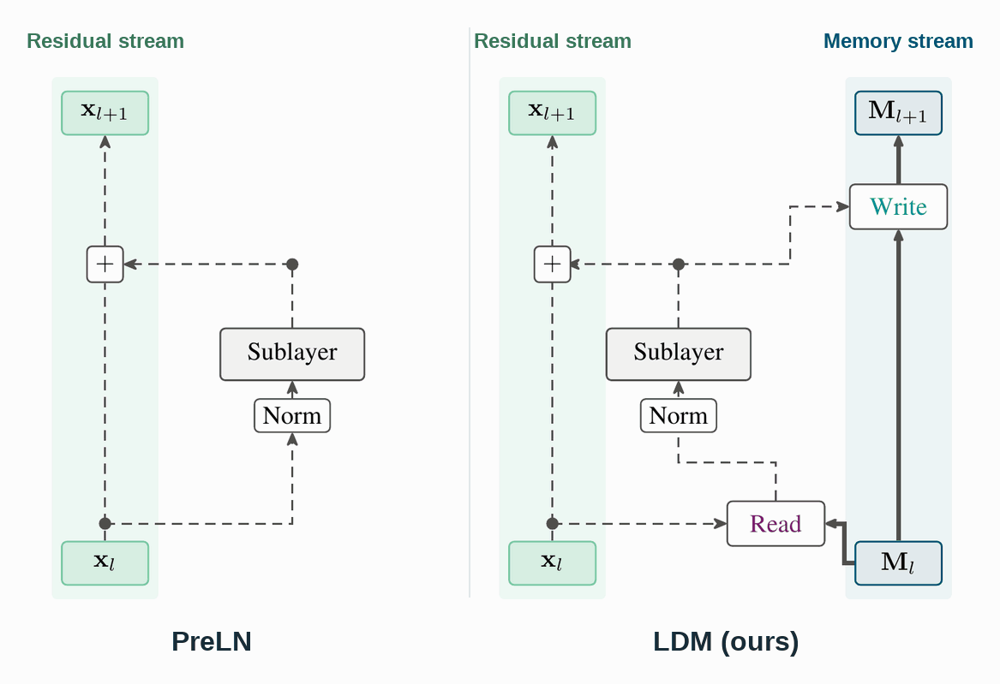

<h1 align="center">Depth Memory</h1>

<p align="center">
  <a href="https://arxiv.org/pdf/2610.18809"></a>
  &nbsp;
  <a href="https://huggingface.co/collections/davidgonmar/depth-memory-6ac5045a1bd8e798d2ed1392"></a>
</p>

Code for the [Depth Memory](https://arxiv.org/pdf/2610.18809) paper. **Linear Depth Memory (LDM)** augments transformers with a fixed-size associative memory for storing and retrieving information across layers. The repository includes implementations of LDM and the paper's baselines (PreLN, Attention Residuals in its Block and Full variants, and mHC), along with the training, evaluation and throughput code needed to reproduce the paper's results.

<p align="center">
  
</p>

## Installation

Install dependencies with [uv](https://docs.astral.sh/uv/):

```bash
uv sync --frozen
source .venv/bin/activate
```

This installs `pretrain/OLMo-core` in editable mode. The commands below assume the environment is
active.

### Hardware

- **Fast LDM backends:** NVIDIA Hopper (H100) or Blackwell (B200) GPUs.
- **Other LDM backends:** `flexible` supports recent CUDA GPUs; `reference` supports CPU and CUDA.
- **mHC:** requires a CUDA toolkit with `nvcc` on `PATH`.

## Data

The models are trained on the 100B-token sample of FineWeb-Edu (`sample/100BT` of
[`HuggingFaceFW/fineweb-edu`](https://huggingface.co/datasets/HuggingFaceFW/fineweb-edu)),
tokenized with OLMo's GPT-NeoX Dolma v1.5 tokenizer (vocabulary 50,280).

```bash
# Download the parquet shards of sample/100BT into data/fineweb-edu/100BT, then:
mkdir -p data/fineweb-edu/eval
mv data/fineweb-edu/100BT/013_00008.parquet data/fineweb-edu/eval/

python data_utils/tokenize_from_pretrain_datasets.py \
  --train-parquet-glob "data/fineweb-edu/100BT/*.parquet" \
  --eval-parquet-path data/fineweb-edu/eval/013_00008.parquet \
  --output-dir data/fineweb-edu/tokenized \
  --text-field text \
  --tokenizer-name-or-path pretrain/OLMo-core/src/olmo_core/data/tokenizers/allenai_gpt-neox-olmo-dolma-v1_5.json \
  --vocab-size 50280 --eos-token-id 50279 --pad-token-id 1 \
  --batch-size 4096 --skip-existing

export DATA_DIR=$PWD/data/fineweb-edu/tokenized
```


## Reproducing the paper

Set the data path, Weights & Biases entity, and checkpoint directory:

```bash
export DATA_DIR=... WANDB_ENTITY=... CHECKPOINT_DIR=...
```

See [paper-experiments/README.md](paper-experiments/README.md) for the full training setup.

### Training and evaluation

Train each model at the learning rate selected in the paper:

```bash
# 400M models, 50B tokens
bash paper-experiments/pretrain/launch.sh 400m preln         0.001
bash paper-experiments/pretrain/launch.sh 400m attnres_full   0.004
bash paper-experiments/pretrain/launch.sh 400m attnres_block  0.002
bash paper-experiments/pretrain/launch.sh 400m mhc           0.002
bash paper-experiments/pretrain/launch.sh 400m ldm_k4        0.001
bash paper-experiments/pretrain/launch.sh 400m ldm           0.001

# 1.5B models, 100B tokens
bash paper-experiments/pretrain/launch.sh 1p5b preln         0.001
bash paper-experiments/pretrain/launch.sh 1p5b attnres_block 0.001
bash paper-experiments/pretrain/launch.sh 1p5b mhc           0.001
bash paper-experiments/pretrain/launch.sh 1p5b ldm           0.001
```

On H100 GPUs, pass `--gpu h100` before the scale, e.g. `bash paper-experiments/pretrain/launch.sh --gpu h100 400m ldm 0.001`.
To reproduce the learning-rate sweeps, repeat at `5e-4`, `1e-3` and `2e-3` (`1e-3`, `2e-3` and `4e-3` for AttnRes at 400M).

Evaluate a checkpoint:

```bash
bash paper-experiments/pretrain/evaluation/run.sh \
  "$CHECKPOINT_DIR/<run>/step47684" my-results/ldm.json
```

### Ablations

Run 400M ablations for 15B tokens at a learning rate of `1e-3`:

```bash
bash paper-experiments/ablations/launch.sh ldm b200
bash paper-experiments/ablations/launch.sh preln b200
bash paper-experiments/ablations/launch.sh delta_rule b200
```

See [paper-experiments/ablations/README.md](paper-experiments/ablations/README.md)
for all variants and their definitions.

### Throughput and memory

Benchmark training (8 GPUs), prefill, and decode (1 GPU):

```bash
bash paper-experiments/throughput/rounds.sh train   1p7b b200 3
bash paper-experiments/throughput/rounds.sh prefill 1p7b b200 3
bash paper-experiments/throughput/rounds.sh decode  1p7b b200 3
```

See [paper-experiments/throughput/README.md](paper-experiments/throughput/README.md)
for the benchmark setup.

## Released checkpoints

Checkpoints are available in our [Hugging Face collection](https://huggingface.co/collections/davidgonmar/depth-memory-6ac5045a1bd8e798d2ed1392). Each model repository contains one folder per learning rate; its model card identifies the run selected in the paper.

| Method | 400M | 1.5B |
|---|---|---|
| PreLN | [Download](https://huggingface.co/davidgonmar/depth-memory-400m-preln) | [Download](https://huggingface.co/davidgonmar/depth-memory-1.5b-preln) |
| AttnRes (Full) | [Download](https://huggingface.co/davidgonmar/depth-memory-400m-attnres-full) | — |
| AttnRes (Block) | [Download](https://huggingface.co/davidgonmar/depth-memory-400m-attnres-block) | [Download](https://huggingface.co/davidgonmar/depth-memory-1.5b-attnres-block) |
| mHC | [Download](https://huggingface.co/davidgonmar/depth-memory-400m-mhc) | [Download](https://huggingface.co/davidgonmar/depth-memory-1.5b-mhc) |
| LDM | [Download](https://huggingface.co/davidgonmar/depth-memory-400m-ldm) | [Download](https://huggingface.co/davidgonmar/depth-memory-1.5b-ldm) |
| LDM, D_k = 4 | [Download](https://huggingface.co/davidgonmar/depth-memory-400m-ldm-dk4) | — |

Download and evaluate a checkpoint:

```bash
hf download davidgonmar/depth-memory-400m-ldm \
  --include "lr1e-3/*" --local-dir ldm-400m

bash paper-experiments/pretrain/evaluation/run.sh ldm-400m/lr1e-3 results.json
```

## Layout

```text
pretrain/OLMo-core/                   OLMo-core (Apache-2.0) with the paper's methods added
  src/olmo_core/nn/ldm/               LDM: config, modules and four backends
    backends/reference.py             readable FP32 reference implementation
    backends/flexible/                Triton kernels; every ablation option (the 400M ablations)
    backends/fast/                    CuTe DSL training kernels with tuned launch tables (main runs)
    backends/fast_inference/          CuTe DSL prefill and decode kernels with tuned launch tables
  src/olmo_core/nn/hyper_connections.py, nn/mhc_ops.py   mHC
  src/olmo_core/kernels/tile_kernels/                    DeepSeek TileKernels, mHC subset (MIT)
  src/olmo_core/kernels/attnres.py                       AttnRes kernels from FLA (MIT)
paper-experiments/
  pretrain/          training recipe (train.py), launcher, model configs, evaluation
  ablations/         the 400M ablation series: generator, configs, launcher
  throughput/        speed and memory benchmark (training, prefill, decode)
config_utils/        model config loader
data_utils/          FineWeb-Edu tokenization
eval/                lm-eval adapter for native checkpoints
```

`backends/BACKENDS.md` compares the four LDM backends, and the fast backends' `DESIGN.md` files
describe their kernels.


## Citation

```bibtex
@misc{gonzalezmartínez2026depthmemory,
      title={Depth Memory}, 
      author={David González-Martínez and Philipp Nazari and T. Konstantin Rusch and Shiwei Liu},
      year={2026},
      eprint={2610.18809},
      archivePrefix={arXiv},
      primaryClass={cs.LG},
      url={https://arxiv.org/abs/2610.18809}, 
}
```

## Dependencies

This project builds on:

- [**OLMo-core**](https://github.com/allenai/OLMo-core) for model and training infrastructure.
- [**DeepSeek TileKernels**](https://github.com/deepseek-ai/TileKernels) for mHC kernels.
- [**flash-linear-attention**](https://github.com/fla-org/flash-linear-attention) for Attention Residuals kernels.
